<div dir="rtl">

#  تعريب كلود (Claude) لنسخة الويب (غير رسمي)

**إضافة متصفح تعرض مواقع Claude بالعربية، بالاتجاه من اليمين إلى اليسار: تطبيق [claude.ai](https://claude.ai)، ومركزَي المساعدة والخصوصية، والوثائق القانونية، وأكاديمية Claude، ووثائق المطوّرين ووثائق Claude Code.**

مشروع مستقل غير رسمي · محليّ بالكامل · إذن واحد (`storage`) · مفتوح المصدر

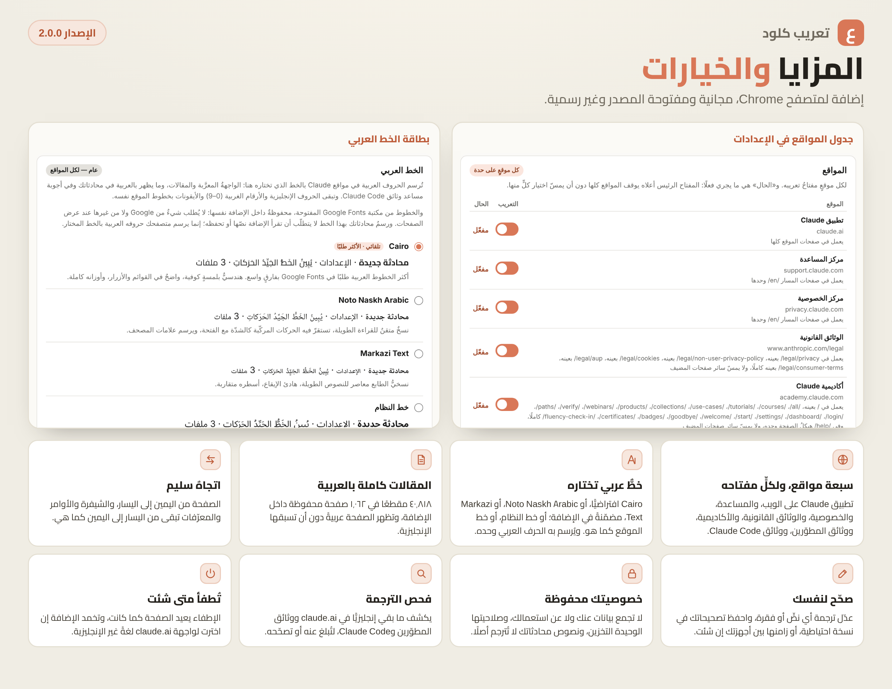

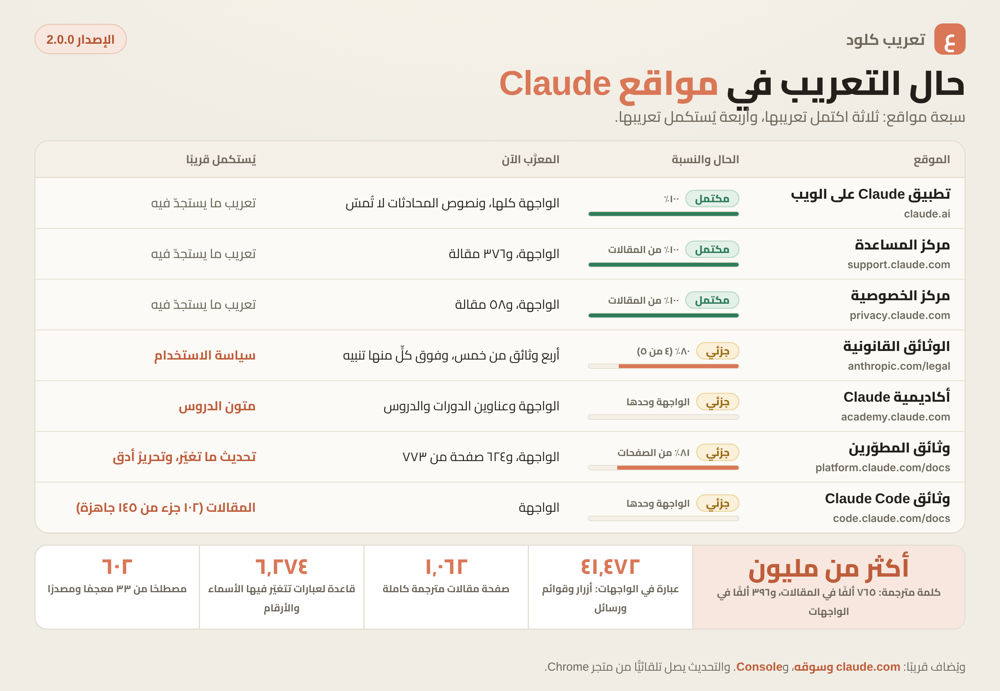

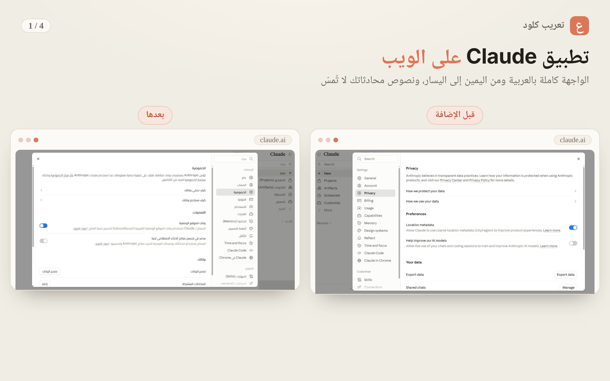

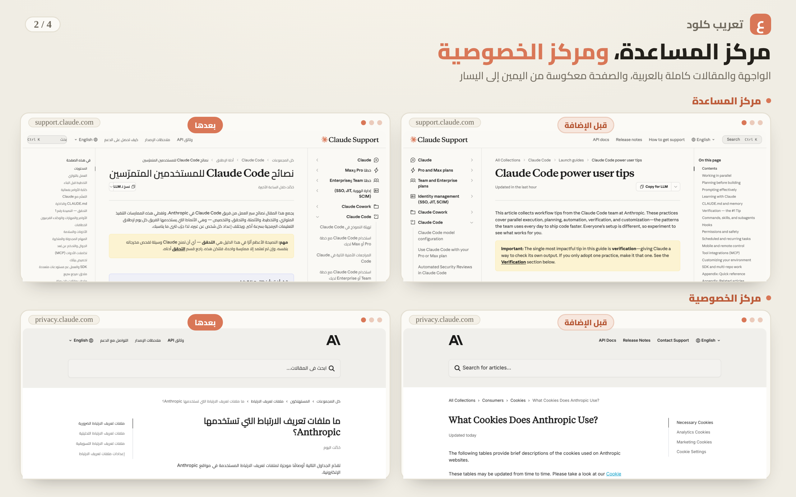

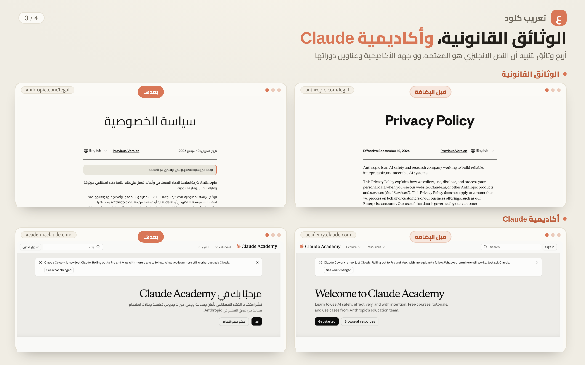

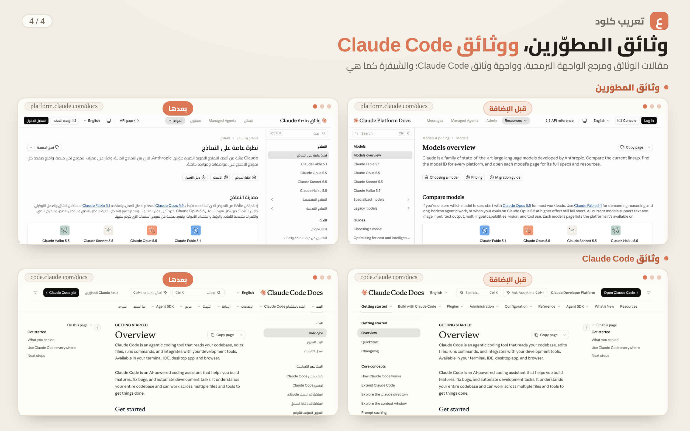

---

## لماذا؟

تعرض الشركة مواقع Claude بلغاتٍ عدّة، ليست العربية منها ولا لغةٌ من اللغات ذات الاتجاه من اليمين إلى اليسار. ودعمُ هذا الاتجاه
فيها ناقص: النصّ العربي يُحاذى يسارًا، ويختلّ ترتيبُه إذا خالطته إنجليزيةٌ أو أرقام أو تعليمات برمجية. هذه الإضافة تسدّ الأمرين
معًا: **تترجم الصفحات، وتعكس اتجاهها**.

## أين تعمل

| الموقع | الحال | ما يُعرَّب |
|---|---|---|
| **تطبيق Claude**، `claude.ai` | كامل | الواجهة: 34,457 نصًّا، و6,168 قاعدةً للنصوص المتغيّرة. ونصّ المحادثات لا تلمسه الترجمة |
| **مركز المساعدة**، `support.claude.com` | كامل | الواجهة (1,017 نصًّا) والمقالات: 18,168 مقطعًا في 376 صفحةً |
| **مركز الخصوصية**، `privacy.claude.com` | كامل | الواجهة (235 نصًّا) والمقالات: 871 مقطعًا في 58 صفحةً |
| **الوثائق القانونية**، `www.anthropic.com/legal` | جزئي: أربعُ وثائق من خمس | سياسة الخصوصية، وسياسة الخصوصية لغير المستخدمين، وسياسة ملفات تعريف الارتباط، وشروط الخدمة للمستهلكين (376 مقطعًا)، وفوق كلٍّ منها «ترجمة غير رسمية للاطلاع، والنص الإنجليزي هو المعتمد»؛ وتبقى سياسة الاستخدام بالإنجليزية |
| **أكاديمية Claude**، `academy.claude.com` | جزئي | الواجهة وعناوين الدورات والدروس (3,049 نصًّا)، وتبقى متون الدروس بالإنجليزية |
| **وثائق المطوّرين**، `platform.claude.com/docs` | جزئي | الواجهة (1,777 نصًّا) والمقالات ومرجع الواجهة البرمجية: 21,403 مقاطع في 624 صفحةً، وتبقى التعليمات البرمجية والمعاملات بالإنجليزية؛ والصفحات التي غيّرها الموقع بعد ترجمتها تبقى بالإنجليزية حتى تحديثٍ قادم |
| **وثائق Claude Code**، `code.claude.com/docs` | جزئي | الواجهة وحدها (916 نصًّا) |

وفي المجموع: 41,470 نصًّا للواجهات، و40,818 مقطعًا من المقالات، نحو 990 ألف كلمة عربية. وتكتمل المواقع الجزئية في التحديثات القادمة.
والمقطع فقرةٌ أو عنوانٌ أو بندٌ أو خليةُ جدول. والإضافة خاملةٌ في غير هذه الصفحات: في صفحات اللغات الأخرى من هذه المواقع، وفي
لوحة المطوّرين (Console) على `platform.claude.com`، وفي claude.ai إذا اخترت لواجهته لغةً غير الإنجليزية.

## ما تفعله

| | |
|---|---|
| **ترجمة المقالات** | ترجمةٌ لكل صفحة محفوظةٌ داخل الإضافة، تُقرأ وحدها عند فتح صفحتها، فلا يُجلب شيءٌ من الشبكة: 40,818 مقطعًا في 1,062 صفحةً |
| **عناوين التبويب** | بالعربية في المواقع كلها |
| **قواعد ذكية وصيغ الجمع** | 6,274 قاعدةً للنصوص المتغيّرة («قبل 3 أيام»، «الرسالة 1 من 2»…)، والفئات الست (`zero/one/two/few/many/other`): لا «3 محادثة» ولا «11 محادثات» |
| **الاتجاه من اليمين إلى اليسار** | عكسُ التخطيط بورقةٍ تُبنى من ملفات تصميم الموقع نفسها وتُعاد كلما تغيّرت (وفي مركزَي المساعدة والخصوصية من لقطةٍ تُحدَّث مع كل إصدار)، واتجاهٌ مستقلٌّ لكل فقرة، والتعليمات البرمجية تبقى من اليسار |
| **خطٌّ عربي تختاره** | ثلاثة خطوط من Google Fonts مضمَّنة في الإضافة (Cairo افتراضيًّا، وNoto Naskh Arabic، وMarkazi Text)، أو «خط النظام»، وهو خط جهازك العربي كما كانت الإضافة ترسمه قبل هذا الإصدار، أو «خط الموقع كما هو». يُرسم به الحرف العربي وحده، وتبقى الحروف الإنجليزية والأرقام الغربية بخط الموقع |
| **خيارات لكل موقع** | مفتاح التعريب، ومحرّك الاتجاه، والتصحيحات، وإعادة الضبط، لكل موقعٍ على حدة، و«المواقع كلها» أولًا |
| **تصحيح شخصي** | ابحث في القواميس وعدّل أي ترجمة لنفسك، وصحّح فقرةً من مقالة من قائمة الإضافة، وصدّر تصحيحاتك واستوردها |
| **فحص الترجمة وفحص الاتجاه** | بضغطة منك: يقرأ فحص الترجمة ملفات الموقع العامة ليجد ما استُجدّ ولم يُترجَم (حزم claude.ai، وفهرس الصفحات `llms.txt` في وثائق المطوّرين ووثائق Claude Code)، ويُظهر فحص الاتجاه في claude.ai ما لم يُعكس بعد |
| **مزامنة اختيارية** | تصحيحاتك وقواعدك وتصحيحات الفقرات بين أجهزتك، عبر مزامنة كروم نفسها، متوقّفة ما لم تفعّلها |

## ما لا تعرّبه

- الملفات المرفقة والمنزَّلة، والصفحات خارج المواقع المذكورة، والصور والفيديو.
- التعليمات البرمجية والأوامر، والخصائص والنماذج في مرجع الواجهة البرمجية.
- نصّ المحادثات مع Claude، ومحتوى المُخرَجات (Artifacts)، وأجوبة المساعد في وثائق Claude Code وفي الأكاديمية.
- سياسة الاستخدام في الوثائق القانونية، ومتون دروس الأكاديمية ومتون وثائق Claude Code، في هذا الإصدار.
- ما تتركه الشركة بالإنجليزية في ترجماتها لمواقعها يبقى بالإنجليزية هنا أيضًا. وأسماء أزرار وحدة التحكم (Console) في المقالات
  بالإنجليزية كما تظهر على شاشتها.
- والمقالات مترجمةٌ من نسخة الموقع وقت إعداد الإصدار، فما غيّره الموقع أو أضافه بعده يبقى بالإنجليزية حتى يصل تحديثٌ للإضافة؛
  والمقالة التي تغيّر فيها أكثر من 5٪ من مقاطعها، أو لا ترجمة لها في هذا الإصدار، يبقى متنها كلُّه بالإنجليزية والواجهة حوله عربية،
  وتقول قائمة الإضافة سبب ذلك؛ وما تغيّر فيه 5٪ أو أقل قد تظهر فيه مقاطع إنجليزية قليلة بين العربية.

## الخصوصية — بدقّة

لتترجم الإضافةُ نصًّا فلا بدّ أن **تطابقه**، فهي إذن تقرأ نصوص الصفحة أثناء مرورها عليها وتقارنها بقواميس وترجماتٍ مضمَّنة
داخلها. **والفرق الذي يعنيك أن هذه القراءة عابرة للمطابقة وحدها:**

- **لا يُخزَّن شيء مما يُقرأ، ولا يُراكَم، ولا يُرسَل** — لا إلى تخزين، ولا إلى خادم، ولا إلى أي مكان. وما يُحفظ على جهازك
  تفضيلاتُك وتصحيحاتُك التي تكتبها بنفسك، وما تبنيه الإضافة لعملها: ورقة الاتجاه لكل موقع، ونسخة الخط الذي تختاره، ونتائج الفحص.
- **نصّ المحادثات مستثنًى أصلًا** فلا تلمسه الترجمة — لا رسائلك ولا ردود Claude.
- **لا تجمع الإضافة بيانات عنك ولا عن استعمالك، ولا تستعين بخدمة خارجية:** القواميس وترجمات المقالات والخطوط كلها داخلها.
  والطلبات الشبكية التي تفتحها ثلاثة، كلها تقصد **ملفات المواقع المذكورة العامة وحدها** (من مضيفاتها، أو من مضيفات Claude
  وAnthropic التي تحمّل منها صفحاتُها ملفاتها) ولا يُرسَل فيها شيءٌ من عندك: (١) **محرّك الاتجاه** يقرأ تلقائيًّا ملفات التنسيق
  (CSS) التي حمّلها متصفحك للصفحة نفسها، عند أول تشغيل وعند كل تغيّر في نسخة الموقع، ليبني منها ورقة العكس ويحفظها على جهازك،
  وذلك في claude.ai والوثائق القانونية والأكاديمية ووثائق المطوّرين ووثائق Claude Code (ويمكنك إيقاف ذلك باختيار المحرّك
  «المبسّط» في الإعدادات)؛ (٢) «فحص الترجمة» (ليجد ما استُجدّ ولم يُترجَم) و(٣) «فحص الاتجاه» (ليُظهر ما لم يُعكس بعد) يجريان
  **بضغطةٍ منك وحدك**.
- **الاستثناء الوحيد لمغادرة بياناتك جهازك:** إن فعّلتَ المزامنة الاختيارية (وهي متوقّفة ما لم تُفعّلها) حمل **كرومُ نفسُه**
  تصحيحاتِك وقواعدَك وتصحيحات الفقرات، دون إعداداتك ودون شيءٍ من محتواك أو محادثاتك، إلى حسابك في جوجل بمزامنته المعتادة، لا
  باتصالٍ تفتحه الإضافة. **وجوجل قد تطّلع عليها ما لم تفعّل عبارة مرور المزامنة في كروم نفسه.** وتبقى لك أزرار إيقافها ومسح ما رُفع.
- **لا تعمل إلا في المواقع المذكورة أعلاه.** وستعرض لك كروم عند التثبيت عبارتها المعيارية «قراءة بياناتك وتغييرها» على هذه
  المواقع، وهي الصيغة التي تصف بها كلَّ إضافة تعمل داخل صفحة، ومعناها هنا أن الإضافة تكتب الترجمة داخل الصفحة. والإذن الوحيد الذي
  تطلبه سوى ذلك `storage`، لحفظ تفضيلاتك على جهازك.

نقولها بهذه الدقّة لأن الوعد المتجاوِز أضعفُ من الوعد الدقيق: المشروع مفتوح المصدر، فكلُّ سطرٍ من هذا يمكنك التحقق منه بنفسك.
التفصيل في [سياسة الخصوصية](PRIVACY.md).

## التثبيت

**من متجر Chrome (الطريقة الموصى بها):** [ثبّت الإضافة من المتجر](https://chromewebstore.google.com/detail/ilebkilcahbijffokjmlakbocdjkojbe) — تثبيتٌ بضغطة وتحديثٌ تلقائي. وما الجديد والقيود المعروفة في [سجلّ الإصدارات](CHANGELOG.md).

> **من كانت عنده 1.0.0:** يطلب كروم عند التحديث إلى 2.0.0 موافقتك على المواقع الجديدة، ويوقف الإضافة حتى توافق من قائمة
> الإضافات أو من `chrome://extensions`. وتبقى إعداداتك وتصحيحاتك كما هي.

ويلزم Chrome 120 أو أحدث.

**يدويًّا (نسخة التطوير):**

1. نزّل المستودع أو انسخه.
2. افتح `chrome://extensions` وفعّل **وضع المطوّر**.
3. اضغط **تحميل غير محزومة** واختر المجلد `extension`.
4. افتح أحد المواقع المذكورة، [claude.ai](https://claude.ai) مثلًا، فتظهر الواجهة بالعربية.

> بعد أي تحديث للإضافة: اضغط **↻** على بطاقتها في `chrome://extensions`، ثم **Ctrl+Shift+R** على تبويب الموقع. إعادة تحميل
> الإضافة لا تُحدِّث سكربتها في التبويبات المفتوحة من قبلُ.

### إيدج وسائر متصفحات Chromium

**إيدج وBrave وOpera** وكل ما بُني على Chromium: الإضافة نفسها تعمل عليها بلا تعديل — ثبّتها من
متجر Chrome مباشرة، أو يدويًّا بالخطوات أعلاه من `edge://extensions`.

**فايرفوكس:** غير مدعوم رسميًّا بعد. للمطوّرين نسخة تجريبية تُبنى محليًّا، ولم تُجرَّب على المواقع التي أضافها 2.0.0 — انظر «للمساهمين».

---

## كيف أُنجزت الترجمة — إفصاح

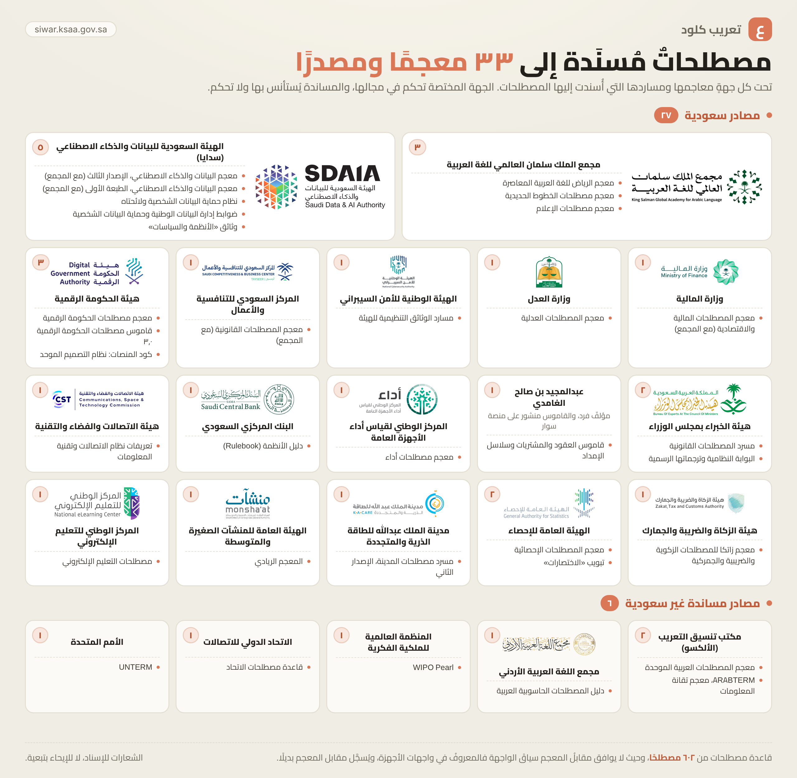

بُنيت القواميس وتُرجمت المقالات **بمعونة [Claude Code](https://claude.com/claude-code)** (أداة Anthropic للبرمجة بالذكاء
الاصطناعي)، على قواعد مصطلحية ثابتة وضعها صاحب المشروع:

- ما يُترجَم، وما يبقى إنجليزيًّا بلا ترجمة (العلامات التجارية والمصطلحات التقنية)؛ والقاعدة العامة: ما تترجمه الشركة في مواقعها
  نترجمه، وما تتركه بالإنجليزية نتركه.
- المصطلحات مُسنَدةٌ إلى 33 معجمًا ومصدرًا: 27 سعوديًّا تحكم فيها الجهة المختصة في مجالها، وفي مقدّمتها **معجم الرياض للغة
  العربية المعاصرة** و**معجم البيانات والذكاء الاصطناعي** (مجمع الملك سلمان العالمي للغة العربية وسدايا، على منصة سوار)، و6
  مساندة غير سعودية يُستأنس بها ولا تحكم. وحيث لا يوافق مقابلُ المعجم سياقَ الواجهة فالمعروفُ في واجهات الأجهزة، مع تسجيل مقابل
  المعجم بديلًا. والقائمة كاملةً أدناه، وفي صفحة «حول» داخل الإضافة.
- نمط «الترجمة (English)» للعناوين المستقلة، والعربيةُ وحدها داخل الجُمل.
- توحيد المصطلح الواحد عبر 41,470 نصًّا في قواميس الواجهات.

وتُرجمت المقالات دفعةً دفعة: لكل دفعةٍ مترجمٌ ثم مراجعٌ منفصلٌ عنه ثم مدقّقٌ آلي، ثم مرّت بمرور اتساقٍ بين الدفعات أو بتحريرٍ
على مستوى المقالة أو بكليهما؛ ولم يجرِ التحرير على مستوى المقالة لوثائق المطوّرين بعد. ومرّت نصوص القواميس بتدقيقٍ آلي (تغطية،
وسلامة المتغيّرات، واتساق المصطلح) ومراجعة.

**ونصرّح بهذا لأن من حقّك أن تعرف كيف صُنع ما تقرؤه.** ومع ذلك تبقى فيه أخطاء ولا بدّ —
ولهذا صُنع التصحيح الشخصي: صحّح ما استُشكل عليك لنفسك في أي وقت، أو
[افتح مسألة](https://github.com/al-ashalash/claude-arabic-chrome/issues) لتصحيحه للجميع.

<details>
<summary><b>المعاجم والمصادر التي أُسندت إليها المصطلحات (33)</b></summary>

**المصادر السعودية (27)**

- معجم الرياض للغة العربية المعاصرة — مجمع الملك سلمان العالمي للغة العربية (سوار)
- معجم البيانات والذكاء الاصطناعي (الإصدار الثالث) — الهيئة السعودية للبيانات والذكاء الاصطناعي (سدايا) ومجمع الملك سلمان العالمي للغة العربية (سوار)
- معجم المصطلحات المالية والاقتصادية — مجمع الملك سلمان العالمي للغة العربية مع وزارة المالية وجهات مالية حكومية (منها هيئة السوق المالية وهيئة الزكاة والضريبة والجمارك) (سوار)
- نظام حماية البيانات الشخصية ولائحته التنفيذية ولائحة نقل البيانات الشخصية خارج المملكة — الهيئة السعودية للبيانات والذكاء الاصطناعي (سدايا)
- ملاحق «مصطلحات وتعريفات» و«قائمة الاختصارات» في الوثائق التنظيمية للهيئة (ECC-2:2024، CCC-2:2024، DCC-1:2022، OTCC-1:2022، وغيرها) — الهيئة الوطنية للأمن السيبراني
- معجم المصطلحات القانونية — مجمع الملك سلمان العالمي للغة العربية والمركز السعودي للتنافسية والأعمال، مع أكثر من ثلاثين جهة حكومية (سوار)
- معجم البيانات والذكاء الاصطناعي (الطبعة الأولى، 2022) — الهيئة السعودية للبيانات والذكاء الاصطناعي (سدايا) ومجمع الملك سلمان العالمي للغة العربية
- معجم مصطلحات الحكومة الرقمية — هيئة الحكومة الرقمية (سوار)
- معجم مصطلحات الخطوط الحديدية — مجمع الملك سلمان العالمي للغة العربية (سوار)
- مسرد المصطلحات القانونية — هيئة الخبراء بمجلس الوزراء (شعبة الترجمة الرسمية) (سوار)
- قاموس مصطلحات الحكومة الرقمية، الإصدار ٣٫٠ — هيئة الحكومة الرقمية (بمراجعة لغوية من مجمع الملك سلمان العالمي للغة العربية)
- قاموس العقود والمشتريات وسلاسل الإمداد — عبدالمجيد بن صالح الغامدي (سوار)
- معجم مصطلحات مركز قياس أداء الأجهزة العامة — المركز الوطني لقياس أداء الأجهزة العامة (أداء) (سوار)
- دليل الأنظمة (Rulebook): نظام المدفوعات وخدماتها ولائحته التنفيذية، ومسارد الصمود السيبراني — البنك المركزي السعودي
- التعريفات في نظام الاتصالات وتقنية المعلومات (١٤٤٣هـ) ولائحته التنفيذية والوثائق التنظيمية للهيئة — هيئة الاتصالات والفضاء والتقنية
- معجم زاتكا للمصطلحات الزكوية والضريبية والجمركية، طبعة ١٤٤٨هـ — هيئة الزكاة والضريبة والجمارك
- معجم المصطلحات الإحصائية — الهيئة العامة للإحصاء (سوار)
- ضوابط ومواصفات إدارة البيانات الوطنية وحماية البيانات الشخصية — مكتب إدارة البيانات الوطنية، الهيئة السعودية للبيانات والذكاء الاصطناعي (سدايا)
- مسرد مصطلحات مدينة الملك عبدالله للطاقة الذرية والمتجددة (الإصدار الثاني) — مدينة الملك عبدالله للطاقة الذرية والمتجددة
- معجم المصطلحات العدلية (إنجليزي-عربي)، الإصدار الأول — وزارة العدل، مركز البحوث
- البوابة النظامية: نصوص الأنظمة وترجماتها الرسمية (المادة الأولى في كل نظام) — هيئة الخبراء بمجلس الوزراء
- معجم المصطلحات الإحصائية وتبويب «الاختصارات» — الهيئة العامة للإحصاء
- معجم مصطلحات الإعلام — مجمع الملك سلمان العالمي للغة العربية (سوار)
- كود المنصات: نظام التصميم الموحد (الإصدار ٤٫٠) — هيئة الحكومة الرقمية
- المعجم الريادي — الهيئة العامة للمنشآت الصغيرة والمتوسطة (منشآت)
- مصطلحات التعليم الإلكتروني — المركز الوطني للتعليم الإلكتروني
- وثائق «الأنظمة والسياسات» في موقع سدايا — الهيئة السعودية للبيانات والذكاء الاصطناعي (سدايا)

**المصادر المساندة، غير السعودية (6)**

- معجم المصطلحات العربية الموحدة — المنظمة العربية للتربية والثقافة والعلوم (مكتب تنسيق التعريب) (سوار)
- ويبو بورل (WIPO Pearl) — المنظمة العالمية للملكية الفكرية
- ARABTERM، معجم تقانة المعلومات — المنظمة العربية للتربية والثقافة والعلوم (مكتب تنسيق التعريب)
- قاعدة مصطلحات الاتحاد الدولي للاتصالات — الاتحاد الدولي للاتصالات
- دليل المصطلحات الحاسوبية العربية (الطبعة الأولى) — مجمع اللغة العربية الأردني
- قاعدة مصطلحات الأمم المتحدة (UNTERM) — الأمم المتحدة

والموسومة «سوار» من معاجم منصة سوار ([siwar.ksaa.gov.sa](https://siwar.ksaa.gov.sa))، ومقابلاتها منسوبةٌ إلى معجمها وإلى المنصة
وإلى مجمع الملك سلمان العالمي للغة العربية.

</details>

---

## للمساهمين

### تصحيح ترجمة

أسهل طريق: **افتح [مسألة](https://github.com/al-ashalash/claude-arabic-chrome/issues)** واذكر الموقع والصفحة، والنصّ
الإنجليزي كما هو، والترجمة الحالية، والترجمة التي تقترحها، وسببها.

أو عدّل القاموس مباشرة وأرسل طلب سحب: `dictionaries/ar.json` لواجهة claude.ai، و`ar-<الموقع>.json` لواجهة كل موقعٍ
آخر (`support` و`privacy` و`legal` و`academy` و`docs` و`code`). أما ترجمات المقالات (`ar-<الموقع>.blocks.json`) فبصماتٌ
وعربيةٌ فقط، فتصحيحها بمسألةٍ أيسر. ثم:

```bash
node tools/build.mjs
```

### إضافة لغة

```bash
node tools/addlang.mjs <code> <endonym> <EnglishName>
```

ثم ترجم `dictionaries/<code>.json` وأعد البناء. الاتجاه يُكتشف تلقائيًّا.

### نسخة فايرفوكس التجريبية (للمطوّرين)

فايرفوكس MV3 يريد مانيفستًا مختلفًا قليلًا، فتُبنى نسخته على حدة:

```bash
node tools/build-firefox.mjs
```

ثم تُحمَّل **مؤقتةً** من `about:debugging#/runtime/this-firefox` (اختر `manifest.json` من المجلد
المولَّد `extension-firefox`؛ تزول بإغلاق المتصفح). ومنذ فايرفوكس 127 لا تُمنح أذونات المواقع عند التثبيت: افتح صفحة إعدادات
الإضافة واضغط «منح الإذن لمواقع Claude» ثم حدّث تبويبات المواقع.

### الاختبارات

صفحات الاختبار 39 في `test`، يشغّلها كلها بلا واجهة مشغّلٌ يقرأ النتيجة من عنوان كل صفحة (يلزم Chrome، ومع `CI=true`
يعمل بلا sandbox كما في عدّائي CI):

```bash
node tools/run-tests-cdp.mjs
```

أو شغّل خادم الاختبارات ثم افتح الصفحات منه، واقرأ النتيجة من **عنوان التبويب** (`اسم N/N` = كله ناجح):

```bash
node tools/serve-tests.mjs
```

ثم افتح `http://localhost:8794/test/<الصفحة>`. فتحُ الصفحات بالنقر المزدوج (`file://`)
لا يصلح للفحص الكامل: المتصفح يمنع `fetch` هناك، فالصفحات التي تحتاجها تتخطى ذلك الجزء
بصفّ إرشادٍ ظاهر بدل إخفاقات كاذبة.

| الملفات | ما تختبره |
|---|---|
| `_selftest.html`، `_ruletest.html`، `_textmaxtest.html`، `_titletest.html`، `_usernamedtest.html` | المحرّك: الترجمة والأنماط والجموع، والقواعد الذكية، والنصوص الطويلة، وعناوين التبويب، وأسماءٌ كتبها المستخدم لا تُعرَّب |
| `_dirtest.html`، `_rtltest.html`، `_livetest.html`، `_liveapptest.html`، `_thumbtest.html` | الاتجاه: نص المحادثة، ومحرّك العكس، والورقة الحيّة، والمؤشر المنزلق |
| `_scantest.html`، `_scanlocktest.html`، `_llmstest.html`، `_swtest.html`، `_swmsgtest.html`، `_harvesttest.html` | الفحص وحجزه، وفحص فهرس الصفحات (llms.txt)، وعامل الخدمة ورسائله، وهوية الحاصد |
| `_synctest.html`، `_syncsimtest.html`، `_blocksynctest.html` | المزامنة الاختيارية بأجهزةٍ متعددة، ومزامنة تصحيحات الفقرات |
| `_blocktest.html`، `_apireftest.html`، `_codetest.html`، `_intercomtest.html`، `_legaltest.html`، `_academytest.html` | المقالات، ومرجع الواجهة البرمجية، ووثائق Claude Code، ومركزا المساعدة والخصوصية، والوثائق القانونية، والأكاديمية |
| `_hosttest.html`، `_routetest.html`، `_sitelangtest.html`، `_holdtest.html`، `_holdofftest.html`، `_hydidletest.html`، `_hydlangtest.html`، `_restoretest.html` | عزل المواقع، وحارسا المسار ولغة الموقع، والإمساك حتى الترطيب، والاستعادة عند الإطفاء |
| `_fonttest.html`، `_sysfonttest.html` | الخط العربي و«خط النظام» |
| `_optionstest.html`، `_optionsrevtest.html`، `_termstest.html` | صفحة الإعدادات والنافذة، والبحث في القاموس والتصحيح |

### بنية المشروع

```
extension/      الإضافة الجاهزة (حمّلها غير محزومة)
dictionaries/   ★ القاموس المصدر — المصدر الوحيد للحقيقة
tools/          أدوات البناء (Node خالص، بلا npm)
test/           الاختبارات
```

`dictionary.js` و`dict-*.js` وقطع المقالات في `bodies/` **مولّدة** — لا تعدّلها يدويًّا؛ عدّل القواميس ثم أعد البناء.

---

## الترخيص

[MIT](LICENSE) — الترجمة العربية عملُ هذا المشروع.

الخطوط العربية في `extension/fonts/` مرخّصةٌ برخصة SIL للخطوط المفتوحة 1.1 لا برخصة MIT، ولكل خطٍّ ملف ترخيصه،
وأصحاب حقوقها في `extension/fonts/CREDITS.txt` (انظر [NOTICE](NOTICE)).

النصوص الإنجليزية في قواميس الواجهات مفاتيحُ المطابقة، وهي مملوكة لـ Anthropic PBC، ولا تُدرَج إلا بالقدر اللازم لمطابقة الواجهة
وتعريبها. وقواميس المقالات بصماتٌ وعربيةٌ فقط، بلا نصٍّ إنجليزي.

«Claude» و«Claude.ai» و«Anthropic» علامات تجارية لمالكها. هذا المشروع مستقل غير رسمي، ليس من إنتاج Anthropic ولا تابعًا لها.
وترجمة الوثائق القانونية غير رسمية للاطلاع، والنص الإنجليزي هو المعتمد.

</div>

---

<div dir="ltr">

#  Claude Web — Arabic Localization

A browser extension that shows Claude's websites in Arabic, with proper right-to-left layout: the
[claude.ai](https://claude.ai) app, its help and privacy centers, its legal documents, Claude Academy, and the developer and
Claude Code documentation.

Independent and unofficial · fully local · one permission (`storage`) · open source

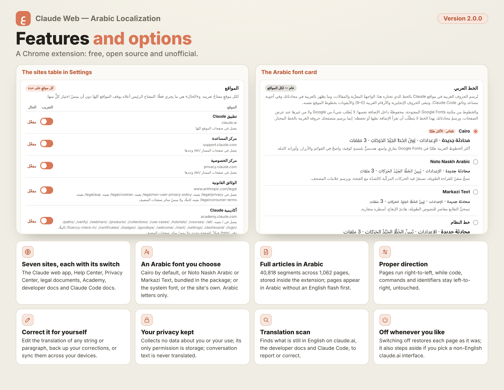

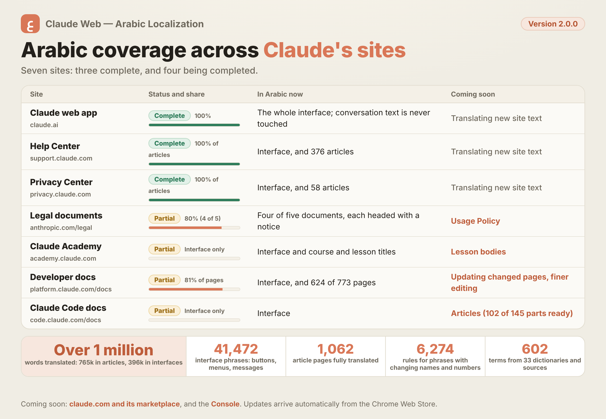

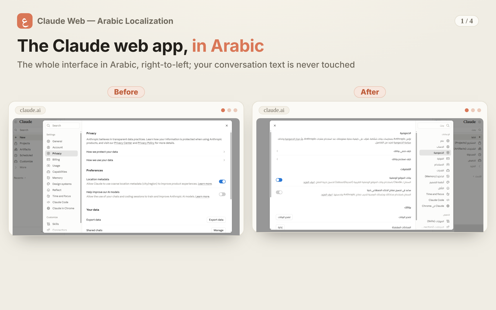

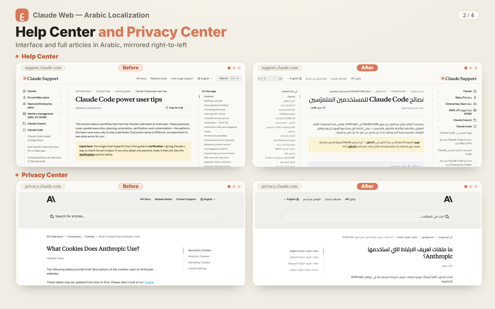

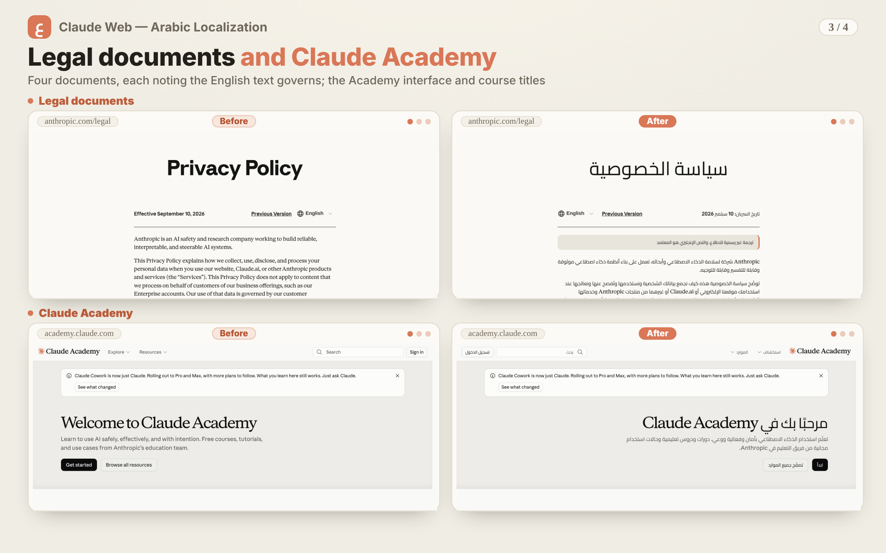

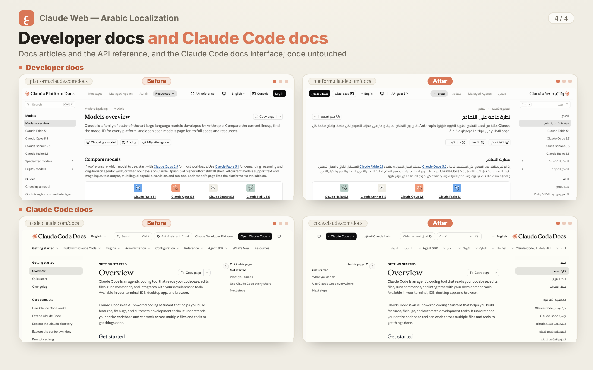

## Why

The company offers Claude's websites in several languages; Arabic is not among them, nor is any right-to-left language. RTL
support is also incomplete: Arabic text is left-aligned, and its order breaks when mixed with English, numbers, or code. This
extension addresses both: **it translates the pages and mirrors their direction.**

## Where it works

| Site | Status | What is translated |
|---|---|---|
| **The Claude app**, `claude.ai` | Full | The interface: 34,457 strings and 6,168 rules for variable text. Conversation text is never touched |
| **Help Center**, `support.claude.com` | Full | The interface (1,017 strings) and the articles: 18,168 segments on 376 pages |
| **Privacy Center**, `privacy.claude.com` | Full | The interface (235 strings) and the articles: 871 segments on 58 pages |
| **Legal documents**, `www.anthropic.com/legal` | Partial: four documents of five | The Privacy Policy, the Non-User Privacy Policy, the Cookie Policy and the Consumer Terms of Service (376 segments), each headed «ترجمة غير رسمية للاطلاع، والنص الإنجليزي هو المعتمد» ("unofficial translation for reference; the English text is authoritative"); the Usage Policy stays in English |
| **Claude Academy**, `academy.claude.com` | Partial | The interface and the course and lesson titles (3,049 strings); lesson bodies stay in English |
| **Developer docs**, `platform.claude.com/docs` | Partial | The interface (1,777 strings), the articles and the API reference: 21,403 segments on 624 pages; code and parameters stay in English, and pages the site changed after translation stay in English until a coming update |
| **Claude Code docs**, `code.claude.com/docs` | Partial | The interface only (916 strings) |

In total: 41,470 interface strings and 40,818 article segments, about 990 thousand Arabic words. The partial sites will be completed in coming updates.
A segment is a paragraph, heading, list item or table cell. The extension stays inactive everywhere else: on these sites' pages in
other languages, in the developer Console on `platform.claude.com`, and on claude.ai when its interface is set to a language other
than English.

## What it does

| | |
|---|---|
| **Article translation** | A translation for each page, bundled inside the extension and read alone when its page opens, so nothing is fetched from the network: 40,818 segments on 1,062 pages |
| **Tab titles** | In Arabic on every site |
| **Smart rules and plurals** | 6,274 rules for variable text ("3 days ago", "message 1 of 2"…), and all six plural categories (`zero/one/two/few/many/other`) — never "3 محادثة" or "11 محادثات" |
| **Right-to-left layout** | The layout is mirrored by a stylesheet built from the site's own CSS and rebuilt whenever the site changes (on the help and privacy centers, from a snapshot updated with each release); each paragraph gets its own direction; code stays left-to-right |
| **An Arabic font of your choice** | Three Google Fonts bundled in the extension (Cairo by default, Noto Naskh Arabic, Markazi Text), or «خط النظام» — your device's own Arabic font, as the extension drew it before this release — or «خط الموقع كما هو», the site's own fonts. It draws Arabic letters only; English letters and Western digits keep the site's font |
| **Per-site options** | Translation switch, direction engine, corrections and reset for each site on its own, with "all sites" first |
| **Personal corrections** | Search the dictionaries and change any translation for yourself, correct a paragraph of an article from the extension's popup, and export or import your corrections |
| **Translation scan and direction check** | On your click: the translation scan reads the site's public files to find newly added strings not yet translated (claude.ai's bundles, and the `llms.txt` page index on the developer and Claude Code docs); the direction check shows, on claude.ai, styles not yet mirrored |
| **Optional sync** | Your corrections, rules and paragraph corrections across your devices, through Chrome's own sync — off unless you turn it on |

## What it does not translate

- Attached and downloaded files, pages outside the sites above, images and video.
- Code and commands, and the properties and models in the API reference.
- Conversation text with Claude, the content of Artifacts, and the assistant's answers in the Claude Code docs and the Academy.
- The Usage Policy among the legal documents, Academy lesson bodies and the Claude Code docs bodies, in this release.
- What the company leaves in English in its own translations of its sites stays in English here too. Console button names in
  articles stay in English, as they appear on that screen.
- The articles were translated from the site as it was when this release was prepared; anything the site changes or adds later
  stays in English until the extension is updated. When more than 5% of an article's segments have changed, or the article has no
  translation in this release, its whole body stays in English with the interface around it in Arabic, and the extension's popup
  says why; an article with 5% or fewer changed segments may show a few English segments among the Arabic.

## Privacy, stated precisely

To translate a string the extension must first **match** it, so it does read page text as it walks the DOM, comparing it against
dictionaries and translations bundled inside the extension. **What matters to you is that those reads are transient and
match-only:**

- **Nothing read is stored, accumulated, or transmitted** — not to storage, not to a server, not anywhere. What is saved on your
  device is your own settings and the corrections you type, and what the extension builds to work: the direction sheet for each
  site, a copy of the font you choose, and scan results.
- **Conversation text is excluded outright** — translation never touches your messages or Claude's replies.
- **The extension collects no data about you or your usage, and uses no external service:** the dictionaries, the article
  translations and the fonts all ship inside it. It makes three kinds of network request, all for **the listed sites' own public
  files only** (served from their hosts, or from the Claude and Anthropic hosts their pages load files from), and nothing of yours is
  sent in any of them: (1) the **RTL engine** automatically reads the stylesheets your browser already loaded for the page — on first
  run and whenever the site ships a new version — to build its mirroring sheet, cached on your device, on claude.ai, the legal
  documents, the Academy, the developer docs and the Claude Code docs (choose the "simplified" engine in the options to turn this
  off); (2) the **translation scan** (newly added untranslated strings) and (3) the **direction check** (styles not yet mirrored)
  run **only when you press a button**.
- **The one exception to data leaving your device:** if you enable the optional cross-device sync (off unless you turn it on), the
  corrections, rules and paragraph corrections you wrote yourself — never your settings, and never any of your content or
  conversations — are carried by **Chrome's own sync** to your Google account, not by a connection the extension opens. **Google may
  be able to read them unless you set a sync passphrase in Chrome itself.** Buttons to stop it and to wipe what was uploaded remain
  yours.
- **It runs only on the sites listed above.** Chrome's install screen shows its standard "read and change your data" line for these
  sites because the extension writes translations into their pages; the only other permission is `storage`, for your preferences.

We say it this precisely because an overreaching claim is weaker than an exact one, and this is open source: verify it yourself.
Details in the [privacy policy](PRIVACY.md).

## Install

**From the Chrome Web Store (recommended):** [install from the store](https://chromewebstore.google.com/detail/ilebkilcahbijffokjmlakbocdjkojbe) — one-click install
and automatic updates. What's new and known limitations are in the [changelog](CHANGELOG.md).

> **If you have 1.0.0:** when it updates to 2.0.0, Chrome asks you to approve the new sites and keeps the extension off until you
> do, from the extensions menu or `chrome://extensions`. Your settings and corrections stay as they are.

Chrome 120 or later is required.

**Manually (development build):**

1. Download or clone the repository.
2. Open `chrome://extensions` and turn on **Developer mode**.
3. Click **Load unpacked** and choose the `extension` folder.
4. Open one of the sites above, such as [claude.ai](https://claude.ai) — the interface appears in Arabic.

> After updating the extension: press **↻** on its card in `chrome://extensions`, then
> **Ctrl+Shift+R** on the site's tab. Reloading the extension does not refresh its script in
> tabs that were already open.

### Edge and other Chromium browsers

**Edge, Brave, Opera** and anything built on Chromium: the same extension works unchanged — install
it from the Chrome Web Store, or manually with the steps above from `edge://extensions`.

**Firefox:** not officially supported yet. A developer-only build is described under *Contributing*; it has not been tried on
the sites 2.0.0 adds.

---

## How the translation was made — disclosure

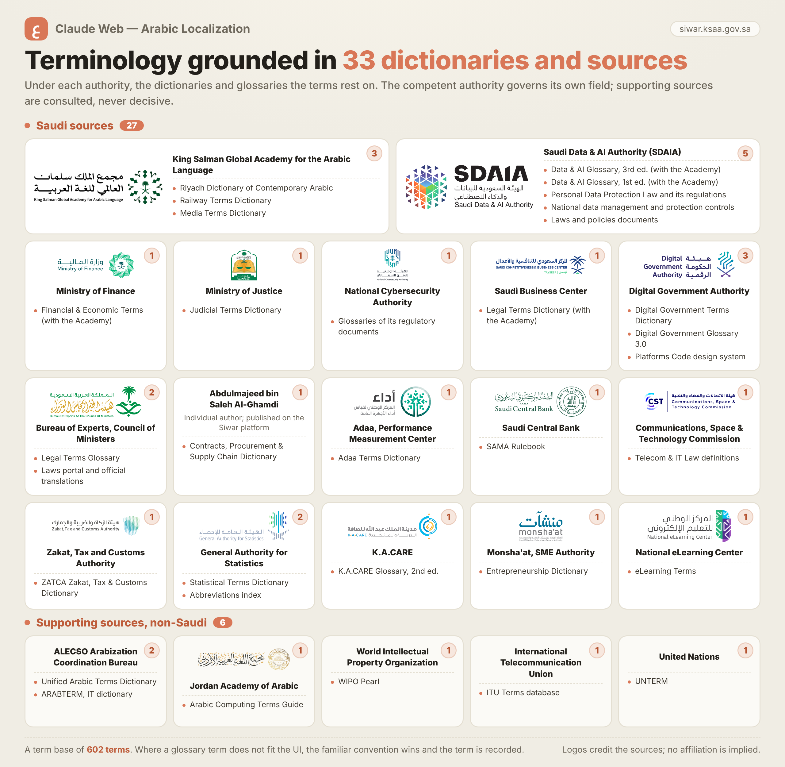

The dictionaries were built and the articles translated **with the help of [Claude Code](https://claude.com/claude-code)**
(Anthropic's AI coding tool), following a fixed terminology rulebook set by the project's author:

- What is translated, and what stays untranslated in English (brand names and technical terms); the general rule: whatever the
  company translates on its sites, we translate, and whatever it leaves in English stays English.
- Terminology rests on 33 lexicons and sources: 27 Saudi ones, where the competent authority decides in its own field — first among
  them the **Riyadh Dictionary of Contemporary Arabic** (معجم الرياض للغة العربية المعاصرة) and the **Data and AI Glossary** (King Salman Global Academy for Arabic
  Language and SDAIA, on the Siwar platform) — and 6 non-Saudi ones that support a choice but never decide it. Where a lexicon's
  equivalent does not fit the interface context, the term users already know from their devices is used, and the lexicon's
  equivalent is recorded as an alternative. The full list, with each publisher, is in the Arabic section above and on the
  extension's About page.
- The "Translation (English)" pattern for standalone headings, Arabic only inside sentences.
- One consistent term across 41,470 interface strings.

The articles were translated batch by batch: each batch by a translator and then a separate reviewer, then an automated validator,
then a cross-batch consistency pass, an article-level editorial pass, or both; the developer docs have not had the article-level
pass yet. The dictionary strings passed automated checks (coverage, placeholder integrity, term consistency) and review.

**We state this plainly because you deserve to know how what you read was made.** Errors
nonetheless remain — which is why personal corrections exist: fix anything for yourself at any
time, or [open an issue](https://github.com/al-ashalash/claude-arabic-chrome/issues) to fix it
for everyone.

---

## Contributing

### Fix a translation

Easiest path: **[open an issue](https://github.com/al-ashalash/claude-arabic-chrome/issues)**
with the site and page, the English text exactly as shown, the current translation, the one you propose, and why.

Or edit the dictionary directly and send a pull request: `dictionaries/ar.json` for the claude.ai interface, and
`ar-<site>.json` for each other site's interface (`support`, `privacy`, `legal`, `academy`, `docs`, `code`). The article
translations (`ar-<site>.blocks.json`) hold fingerprints and Arabic only, so an issue is the easier way to fix them. Then:

```bash
node tools/build.mjs
```

### Add a language

```bash
node tools/addlang.mjs <code> <endonym> <EnglishName>
```

Then translate `dictionaries/<code>.json` and rebuild. Direction is detected
automatically.

### Firefox developer build

Firefox MV3 wants a slightly different manifest, so its build is produced separately:

```bash
node tools/build-firefox.mjs
```

Then load it **temporarily** from `about:debugging#/runtime/this-firefox` (pick `manifest.json`
from the generated `extension-firefox` folder; it goes away when the browser closes). Since
Firefox 127 site permissions are not granted on install: open the extension's options page and press «منح الإذن لمواقع Claude»
("Grant permission for Claude's sites"), then reload the sites' tabs.

### Tests

The 39 test pages in `test` all run headless through a runner that reads each page's result from its title (it needs
Chrome; with `CI=true` it runs without the sandbox, as on CI runners):

```bash
node tools/run-tests-cdp.mjs
```

Or start the test server, open the pages from it, and read the result from the **tab title**
(`name N/N` = all passing):

```bash
node tools/serve-tests.mjs
```

Then open `http://localhost:8794/test/<page>`. Opening the pages by double-click (`file://`)
does not give a full check: the browser blocks `fetch` there, so the pages that need it skip that
part with a visible notice instead of false failures.

| Files | What they test |
|---|---|
| `_selftest.html`, `_ruletest.html`, `_textmaxtest.html`, `_titletest.html`, `_usernamedtest.html` | The engine: translation, patterns, plurals, smart rules, long texts, tab titles, and names the user wrote staying untranslated |
| `_dirtest.html`, `_rtltest.html`, `_livetest.html`, `_liveapptest.html`, `_thumbtest.html` | Direction: chat text, the RTL engine, the live sheet, the slider thumb |
| `_scantest.html`, `_scanlocktest.html`, `_llmstest.html`, `_swtest.html`, `_swmsgtest.html`, `_harvesttest.html` | The scan and its claim, the page-index (llms.txt) scan, the service worker and its messages, the harvester's identity |
| `_synctest.html`, `_syncsimtest.html`, `_blocksynctest.html` | Optional sync across several devices, and paragraph-correction sync |
| `_blocktest.html`, `_apireftest.html`, `_codetest.html`, `_intercomtest.html`, `_legaltest.html`, `_academytest.html` | Articles, the API reference, the Claude Code docs, the help and privacy centers, the legal documents, the Academy |
| `_hosttest.html`, `_routetest.html`, `_sitelangtest.html`, `_holdtest.html`, `_holdofftest.html`, `_hydidletest.html`, `_hydlangtest.html`, `_restoretest.html` | Site isolation, the route and site-language guards, holding the page until hydration, restoring on switch-off |
| `_fonttest.html`, `_sysfonttest.html` | The Arabic font and «خط النظام» |
| `_optionstest.html`, `_optionsrevtest.html`, `_termstest.html` | The options page and the popup, dictionary search and corrections |

### Project layout

```
extension/      the ready extension (load it unpacked)
dictionaries/   ★ the source dictionary — the single source of truth
tools/          build tools (plain Node, no npm)
test/           tests
```

`dictionary.js`, `dict-*.js` and the article files under `bodies/` are **generated** — never edit them by hand; edit the
dictionaries and rebuild.

---

## License

[MIT](LICENSE) for the Arabic translation and code. The Arabic fonts in `extension/fonts/` are licensed under the SIL
Open Font License 1.1, not MIT; each has its licence file, and `extension/fonts/CREDITS.txt` lists the copyright holders
(see [NOTICE](NOTICE)). The English source strings in the interface dictionaries are dictionary keys owned by Anthropic PBC,
included only as far as necessary for interoperability; the article dictionaries hold fingerprints and Arabic only, with no
English text. "Claude", "Claude.ai", and "Anthropic" are trademarks of their owner; this project is independent and unofficial.
The translations of the legal documents are unofficial and for reference; the English text is authoritative.

</div>
